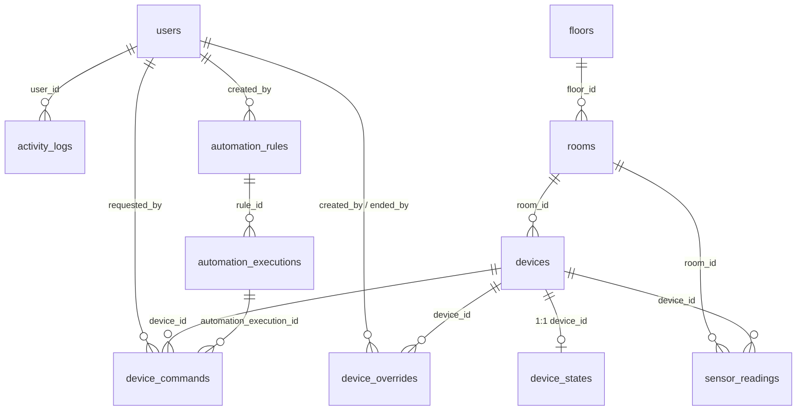

# ORBIT Building — Sistem Manajemen Gedung Pintar

Aplikasi web MVP untuk memantau dan mengelola gedung sekolah (SMK Negeri 1 Adiwerna):
denah 2 lantai, inventaris perangkat, kontrol simulasi on/off, okupansi ruangan,
mode hemat energi, override manual, dan otomatisasi berbasis aturan yang dijalankan
scheduler 30 detik.

**Stack:** CodeIgniter 4.7.4 (PHP 8.2+) · MySQL 8.4 · CSS/JS vanilla (tanpa CDN) · Docker Compose.

---

## Menjalankan

```bash
docker compose up -d --build          # app :8080, db (internal), scheduler
docker compose exec -T app php spark migrate
docker compose exec -T app php spark db:seed DatabaseSeeder
```

Buka `http://localhost:8080/`.

| Item | Nilai |
|---|---|
| Login admin | `admin@orbit.local` / `Orbit-Admin-2026!` |
| Database aplikasi | `orbit_building` (hanya di jaringan Docker) |
| Database uji PHPUnit | `orbit_building_test` (dibuat `docker/mysql/init/01-test-db.sql`) |
| Scheduler | container `orbit-scheduler`, `php spark orbit:scheduler:tick` tiap 30 detik |

Seeder **idempoten** — aman dijalankan berulang, tidak pernah menimpa data yang sudah ada.

```bash
docker compose logs -f scheduler      # log scheduler
docker compose exec -T app php spark orbit:scheduler:tick   # paksa satu tick
```

---

## Halaman & Hak Akses

| Halaman | Route | admin | operator | viewer |
|---|---|:-:|:-:|:-:|
| Dasbor | `/dashboard` | ✓ | ✓ | ✓ |
| Denah lantai | `/denah` | ✓ | ✓ | ✓ |
| Ruangan | `/ruangan`, `/ruangan/{id}` | ✓ | ✓ | ✓ |
| Perangkat | `/perangkat`, `/perangkat/{id}` | ✓ | ✓ | ✓ |
| Otomatisasi | `/otomatisasi`, `/otomatisasi/{id}` | ✓ | ✓ | ✓ |
| Log aktivitas | `/log` | ✓ | ✓ | ✓ |
| Pengguna | `/pengguna` | ✓ | – | – |
| Pengaturan | `/pengaturan` | ✓ | – | – |

**API:** baca (`GET`) semua peran; kontrol (`occupancy`, `mode`, `command`) admin & operator;
manajemen CRUD + override + aturan + pengguna + pengaturan hanya admin.
Semua endpoint API di balik filter `auth` + CSRF (header `X-CSRF-TOKEN`, mode cookie).

| Kelompok | Endpoint utama |
|---|---|
| Baca | `GET api/dashboard`, `api/floors`, `api/rooms`, `api/devices`, `api/overrides`, `api/automation/rules`, `api/automation/executions`, `api/activity-logs` |
| Kontrol | `POST api/rooms/{id}/occupancy`, `api/rooms/{id}/mode`, `api/devices/{id}/command` |
| Manajemen | `POST/PUT api/rooms`, `api/devices`, `api/devices/{id}/position`, `POST api/devices/{id}/archive`, `POST api/overrides`, `api/overrides/{id}/end`, `POST/PUT/DELETE api/automation/rules`, `api/users`, `PUT api/settings`, `PUT api/preferences` |

---

## Posisi & Denah

Dua sistem koordinat, keduanya desimal 0–100 (maks. 2 digit):

1. **Posisi perangkat** (`devices.position_x/position_y`) — persen relatif terhadap
   **area ruangan** (bukan kanvas), sehingga marker tetap tepat di segala ukuran layar.
   Pasangan NULL = belum ditempatkan; X dan Y wajib diisi/dikosongkan bersamaan.
   Perpindahan antar-ruangan lewat edit perangkat (`PUT api/devices/{id}`), bukan endpoint posisi.
2. **Geometri ruangan di denah** (`rooms.map_x/map_y/map_w/map_h`) — persegi pada
   kanvas lantai 100×100; dipakai `public/js/denah.js` untuk menyusun denah.

---

## Model Data (ERD)



| Tabel | Kolom kunci |
|---|---|
| `users` | `name`, `email`, `password_hash`, `role` (admin/operator/viewer), `is_active`, `failed_login_attempts`, `locked_until`, `theme`, `last_login_at` |
| `floors` | `name`, `slug`, `sort_order` |
| `rooms` | `floor_id`, `name`, `room_type`, `occupancy`, `vacant_since`, `mode`, `is_active`, `archived_at`, `map_x/y/w/h`, `inventory_status`, `floor_verification_status` |
| `devices` | `room_id`, `name`, `device_type`, `control_capability` (controllable/monitor_only), `is_essential`, `position_x/y`, `inventory_status`, `is_active`, `archived_at` |
| `device_states` | `device_id` (UNIQUE), `power_state` (unknown/on/off), `connection_state`, `last_seen_at`, `source` |
| `device_commands` | `device_id`, `room_id`, `requested_by`, `automation_execution_id`, `command`, `status` (pending/success/failed), `executed_at` |
| `sensor_readings` | `room_id`, `device_id`, `metric` (temperature/humidity/occupancy/energy_estimate), `value`, `unit`, `recorded_at` |
| `device_overrides` | `device_id`, `override_type` (persistent/time_limited), `reason`, `starts_at`, `expires_at`, `ended_at` |
| `automation_rules` | `name`, `trigger_type` (vacant_duration), `duration_seconds`, `target_json`, `actions_json`, `is_active`, `last_executed_at` |
| `automation_executions` | `rule_id`, `tick_key` (UNIQUE per rule), `status` (executed/skipped/failed/conflict), `reason`, `details_json` |
| `activity_logs` | `user_id`, `action`, `target_type/target_id`, `device_id`, `room_id`, `source`, `result`, `details_json` |
| `app_settings` | `setting_key` (UNIQUE), `setting_value`, `updated_by` |

---

## Otomatisasi, Override & Scheduler

- **Aturan** (`automation_rules`): pemicu `vacant_duration` — ruangan kosong lebih lama
  dari `duration_seconds`. `target_json = {"room_ids":[...]}` (kosong = semua ruangan),
  `actions_json` hanya `set_room_mode` (mode: active/standby/inactive) dan/atau `turn_off`.
- **Scheduler** (`orbit-scheduler`): tiap 30 detik menjalankan `orbit:scheduler:tick` —
  kadaluarsa override → simulasi sensor (tulis per 300 detik) → eksekusi aturan.
  Anti-duplikat via `GET_LOCK` MySQL + `tick_key` UNIQUE.
- **Override** dibuat admin per perangkat:
  - `persistent` — sampai diakhiri manual; `time_limited` — sampai `expires_at`.
  - **Perintah manual TIDAK diblokir override** — operator/admin tetap bisa menyalakan
    / mematikan perangkat. Override hanya **memblokir tindakan otomatis**
    (aturan dilewati dengan status `skipped`, alasan *Dilindungi override aktif*).
- Semua keputusan otomatisasi tercatat di `automation_executions` + `activity_logs`.

---

## Waktu

- Penyimpanan database selalu **UTC** (`app.Timezone = UTC`).
- Konversi tampilan (Asia/Jakarta) hanya lewat helper `app/Helpers/orbit_helper.php`
  (`orbit_format_datetime`, `orbit_to_jakarta`, dst).

---

## Pengujian

31 test PHPUnit (29 skenario) menutup: autentikasi/RBAC, API ruangan, API perangkat
(termasuk posisi denah), override, otomatisasi, scheduler, pengguna, pengaturan/preferensi.

```bash
docker compose exec -T app php vendor/bin/phpunit                 # semua
docker compose exec -T app php vendor/bin/phpunit --filter AuthTest
```

Catatan teknis:

- `phpunit.dist.xml` memakai grup DB `tests` (`orbit_building_test`); basis test di-migrasi +
  di-seed idempoten tiap test. Basis test dibuat otomatis saat volume MySQL pertama kali
  (`docker/mysql/init/01-test-db.sql`).
- CSRF mode cookie: test menyiapkan cookie + header `X-CSRF-TOKEN` dengan token hex 32 karakter.
- Data uji memakai nama/email unik (`uniqid`) agar aman dijalankan berulang.

---

## Keterbatasan (MVP)

- **Simulasi perangkat**: driver `SimulatedDriver` — tidak ada integrasi hardware asli
  (MQTT/driver fisik). Riwayat perintah & state disimpan penuh untuk ganti driver nanti.
- **Sensor simulasi**: pembacaan temperature/humidity/energy di-generate, bukan sensor asli.
- **Tidak ada registrasi publik** — akun hanya dibuat admin.
- **Dua lantai hardcoded** dalam seeder (Lantai 1 + Lantai 2); penempatan ruangan ke lantai
  menunggu verifikasi admin (status `needs_verification`).
- **Tanpa CDN/offline penuh** sudah dipenuhi (aset lokal), tetapi belum ada PWA/service worker.
